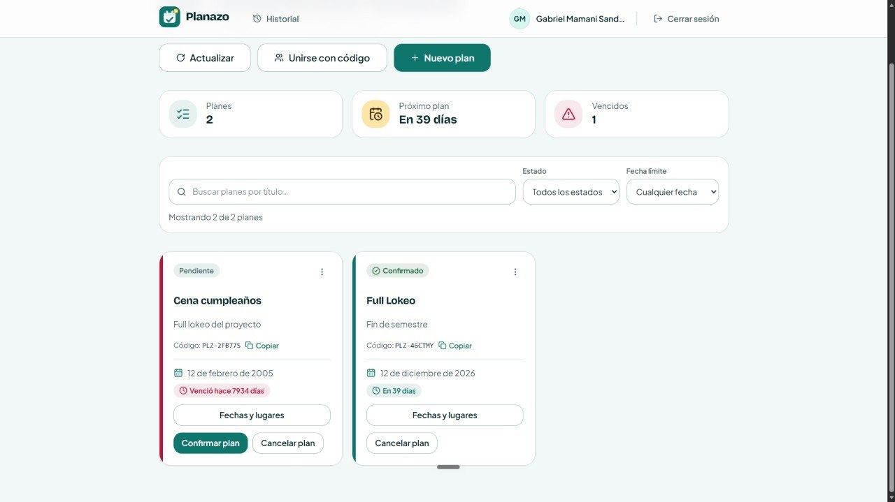

# Feedback a otro proyecto - Clase 19

- **Nombre completo del evaluador:** Gabriel Mamani Sandoval 
- **Mi grupo y caso de estudio:**  Trueque U - Encontrar una publicacion y enviar una oferta desde una cuenta prueba 
- **Grupo y caso de estudio evaluado:** Planazo - Crear un plan, agregar dos opciones y votar por una de ellas 
- **Integrantes del proyecto evaluado:** Saavedra 
- **URL de la app y repositorio evaluado:** [DSaav22/Proyecto-2-IHC-Cambiaso: Se cambiaron los repositorios](https://github.com/DSaav22/Proyecto-2-IHC-Cambiaso)
- **Fecha y versión/commit probado (si está disponible):**  03-11-26

## Primera impresión
¿Qué entendí al entrar? ¿Qué me confundió?

Al entrar se entiende rapido que es una app para organizar planes con amigos o con un grupo. Despues de iniciar sesion te aparece un saludo con tu nombre y el boton de "Nuevo plan" se ve bastante, asi que no tuve que buscar mucho por donde empezar. Tambien estan los cuadritos de resumen (planes, proximo plan, vencidos) que ayudan a ver todo de una.

Lo que me confundio un poco fue que al crear el plan pensé que ahi mismo iba a poder poner las opciones para votar, pero el formulario solo pide titulo, descripcion y fecha limite. Las opciones estan despues, en el boton "Fechas y lugares" dentro de la tarjeta del plan. Una vez que lo encontre ya fue facil, pero al principio no sabia donde estaba.

## Funcionalidad asignada y resultado
Describir la tarea indicada por el docente.

La tarea era crear un plan, agregarle dos opciones y votar por una de ellas. Cree el plan con "Nuevo plan", llene los datos y me salio el mensaje de que se creo bien. Despues entre a "Fechas y lugares", agregue una fecha y un lugar como opciones con el boton "Proponer" y luego vote por una. Se actualizo el contador de votos y me aparecio "Votaste esta opcion", asi que quedo claro que el voto se guardo.

Marcar solo una opción:
- [x] La completé sin ayuda.
- [ ] La completé con ayuda. ¿Cuál?
- [ ] No pude completarla. ¿Dónde me detuve?

## Qué no funcionó
Pasos, resultado esperado y resultado observado.  
Si todo funcionó, indicarlo. Adjuntar captura si ayuda.

En general todo funciono, pude hacer la tarea completa sin errores. Lo unico raro que encontre fue con la fecha:

1. Entrar a "Nuevo plan".
2. Poner un titulo, una descripcion y en "Fecha limite" elegir un dia que ya paso.
3. Darle a "Crear plan".

- **Esperado:** que no me deje crear el plan y me avise que la fecha ya paso.
- **Observado:** el plan se crea igual y directamente aparece como vencido.

## Qué mejoraría y por qué
El plan ahora se puede crear con una fecha pasada. No deberia crearse con una fecha pasada

Otra cosa que mejoraria es la forma de votar. Ahora mismo puedes votar por todas las opciones que quieras, no hay forma de que sea un solo voto. Estaria bueno que el que crea el plan pueda elegir si la votacion es de opcion unica o de opcion multiple, y que eso se pueda configurar segun el tipo. Por ejemplo, en las fechas tiene sentido votar por varias (porque te pueden servir varios dias), pero en el lugar capaz es mejor que cada uno vote solo por uno para que salga un ganador claro. Asi el resultado seria mas facil de leer y no quedarian empates raros.

Tambien pondria algun texto o ayuda despues de crear el plan que diga que las opciones se agregan en "Fechas y lugares", porque a mi me costo un poco encontrar esa parte la primera vez.

## Qué quitaría y por qué
Si no quitaría nada, explicar por qué.

Quitaria el desplegable de "Tipo" que aparece al proponer una opcion, ese donde tienes que abrir la lista para elegir entre Fecha o Lugar. Como son solo dos opciones, abrir un menu para eso es un paso de mas y no se ve a simple vista que existe la opcion de lugar. Lo cambiaria por dos botones uno al lado del otro ("Fecha" y "Lugar"), asi lo ves directo y eliges con un solo clic.

Y de paso tampoco lo dejaria limitado solo a fecha y lugar. Estaria bueno poder proponer otras cosas, como que actividad hacer o que comer, porque al organizar un plan no siempre se decide solo eso.