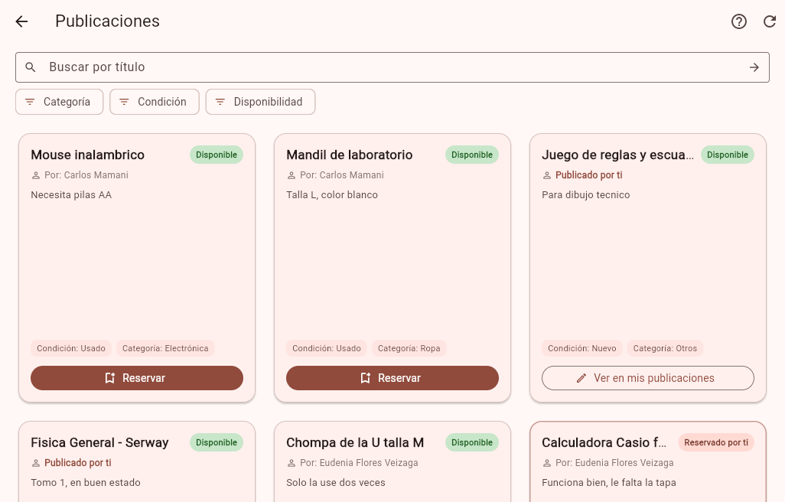

# Clase 17 - Análisis del proyecto recibido

## 1. Proyecto recibido

- **App:** Trueque U
- **Grupo anterior:** Job Natanael Contreras Garzon y Eudenia Gandira Flores Veizaga
- **Repositorio:** https://github.com/gadrilee/TruequeU_2ndP


## 2. Ejecución

El proyecto venia conectado a una base en Neon, nosotros la cambiamos por una base local en Docker (`trueque-u/docker-compose.yml`).
Tambien tuvimos que actualizar `estructura.sql` porque le faltaban columnas que el codigo si usa (`telefono`, `categoria` y la tabla `historial`).

Comandos usados (desde `trueque-u/`):

```bash
# 1. base de datos
docker compose up -d

# 2. backend (puerto 3000)
cd backend
pnpm install
pnpm start

# 3. app (otra terminal)
cd app
flutter pub get
flutter run -d edge
```


Captura funcionando:



## 3. Recorrido: reservar una publicación

| Paso | Qué pasa | Archivo |
|---|---|---|
| **Pantalla** | El usuario ve el feed y presiona "Reservar" en una tarjeta | `app/lib/pantallas/pantalla_feed_publicaciones.dart` (`_reservar`, línea 142) y `app/lib/widgets/tarjeta_feed.dart` |
| **Acción** | Sale un diálogo de confirmación y se llama a `PUT /api/publicaciones/:id/reservado` | `app/lib/estado/controlador_autenticacion.dart` (`reservarPublicacion`, línea 183) → `backend/src/routes/reservas.rutas.js` (línea 15) |
| **Regla** | No puedes reservar lo tuyo (403), no se reserva algo ya intercambiado (409) y solo se reserva si está "disponible" (409) | `backend/src/controllers/reservas.controlador.js` (`putReserva`, líneas 40-58) y `backend/src/utils/reglasObjeto.js` |
| **Datos** | En una transacción se cambia `estado_publicacion` a "reservado", se guarda `id_usuario_reserva` y se crea un evento "reservo" en `historial` | tablas `publicaciones` e `historial` (`base_de_datos/estructura.sql`, modelos en `backend/src/models/`) |

Lo que notamos: hoy la relación entre un usuario y una publicación ajena es solo **una reserva directa** (un solo campo `id_usuario_reserva`), el dueño no decide nada.

## 4. Impacto para la Tarea 5 (ofertas)

La tarea pide: enviar una oferta por una publicación y que el dueño la acepte o la rechace. Eso es una relación nueva (muchos usuarios pueden ofertar por una misma publicación), entonces no alcanza con `id_usuario_reserva`.

Lo que hay que cambiar:

- **Base de datos:** tabla nueva `ofertas` (`id`, `id_publicacion`, `id_usuario`, `estado` = pendiente / aceptada / rechazada, `creado_en`) en `estructura.sql`, más su modelo en `backend/src/models/`.
- **Backend:** `ofertas.rutas.js` y `ofertas.controlador.js` con:
  - `POST /api/publicaciones/:id/ofertas` (enviar oferta)
  - `GET` de las ofertas que recibe el dueño
  - `PUT /api/ofertas/:id/aceptada` y `/rechazada`
- **Reglas** (en `reglasObjeto.js`): no ofertar por lo tuyo, solo ofertar si está disponible y solo el dueño acepta o rechaza.
- **App Flutter:** botón "Hacer oferta" en `tarjeta_feed.dart` y en `pantalla_mis_publicaciones.dart` una lista de ofertas recibidas con Aceptar / Rechazar.
