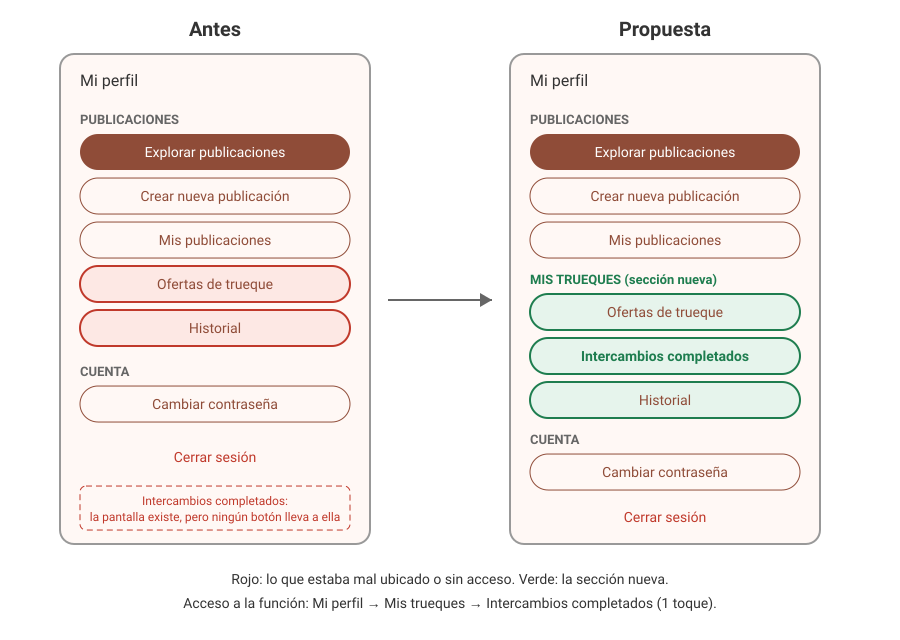
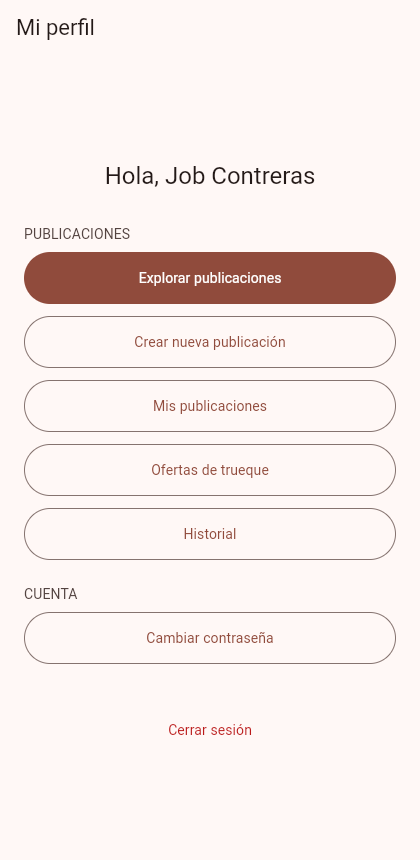
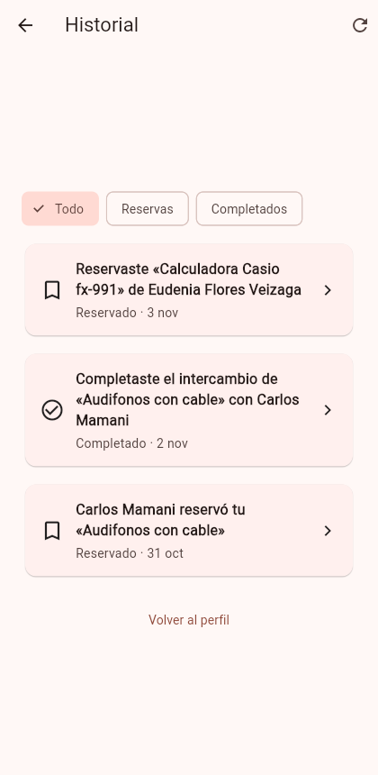
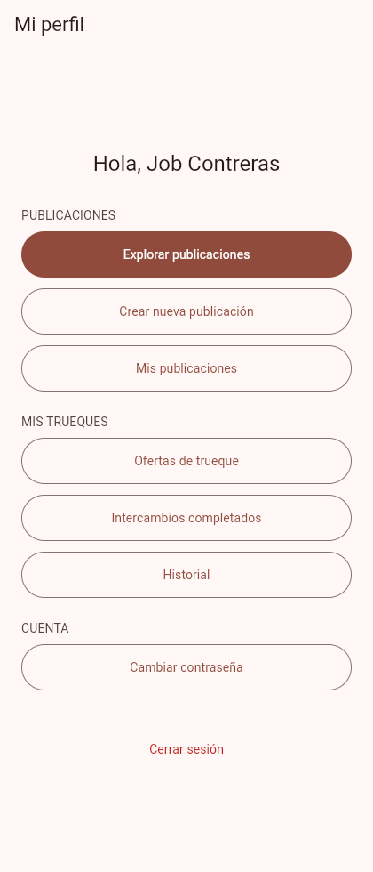
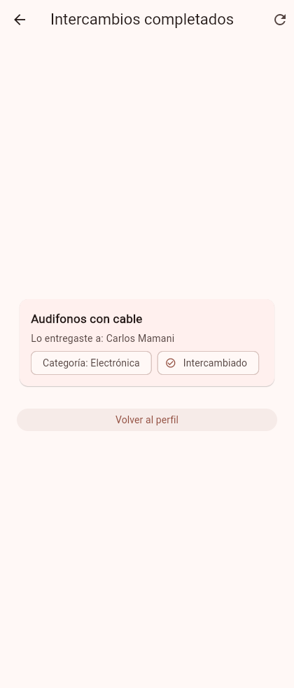

# Clase 20 - Una mejora pequeña de navegación

## Integrantes

- Gabriel Mamani Sandoval
- Ruben Orestes Justiniano Becerra

## Problema

**Tarea difícil de encontrar:** ver los objetos que ya intercambié.

La pantalla "Intercambios completados" existía, pero ningún botón llevaba a ella. Solo se abría escribiendo la ruta `/intercambios`, algo que una persona no va a hacer. Lo más parecido era entrar a "Historial" y filtrar por "Completados", y eso muestra eventos sueltos, no el objeto que entregaste y a quién.

Además, en Mi perfil, "Ofertas de trueque" e "Historial" estaban dentro de la sección "PUBLICACIONES", aunque no hablan de publicaciones sino de lo que pasa en cada trueque.

## Propuesta

| Sección | Etiquetas | Qué agrupa |
|---|---|---|
| PUBLICACIONES | Explorar publicaciones, Crear nueva publicación, Mis publicaciones | Los objetos |
| MIS TRUEQUES (nueva) | Ofertas de trueque, Intercambios completados (nuevo acceso), Historial | Lo que pasa con cada trueque |
| CUENTA | Cambiar contraseña | Los datos de la persona |

Acceso a la función: Mi perfil → Mis trueques → Intercambios completados, con un toque.

## Motivo

- Mi perfil es la pantalla a la que se llega después de iniciar sesión y desde donde se abre todo lo demás, por eso el acceso va ahí.
- Separamos por lo que la persona quiere hacer: una cosa es manejar sus objetos y otra seguir sus trueques.
- Las secciones siguen en orden del proceso: primero ofertas, después intercambios completados y al final el historial de todo.
- No cambiamos los nombres que ya había, para que quien usa la app no tenga que volver a aprenderlos.

## Capturas

| | Mi perfil | Función |
|---|---|---|
| Antes |  |  |
| Después |  |  |

## Resultado de la prueba

**La prueba con una persona de otro grupo no se hizo.** No hubo clase, así que no tuvimos a nadie que resolviera la tarea sin indicaciones. Por eso no registramos un resultado.

Para hacerla, la tarea sería: "Entra con esta cuenta y busca qué objetos ya intercambiaste", sin decirle qué menú abrir.

| Dato | Resultado |
|---|---|
| Sin ayuda / con ayuda / no la encontró | Pendiente |
| Dónde dudó | Pendiente |
| Qué ajustamos después | Pendiente |

Lo que sí revisamos nosotros, que no reemplaza la prueba: en la app, con la cuenta de Job, se entra a Mi perfil, se toca "Intercambios completados" y aparece "Audifonos con cable", entregado a Carlos Mamani.

## Commit

[feat: agrupar los trueques en Mi perfil y dar acceso a intercambios completados](https://github.com/gadrilee/TruequeU_2ndP/commit/e2fc9196202f1dccbb2008bbc86a37dbdc341765)
