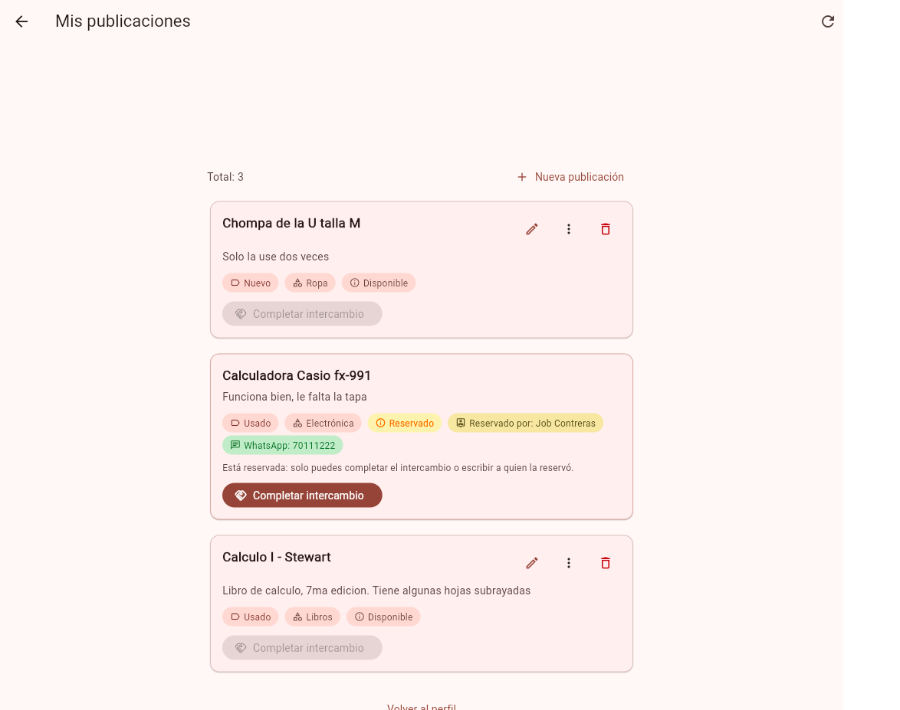
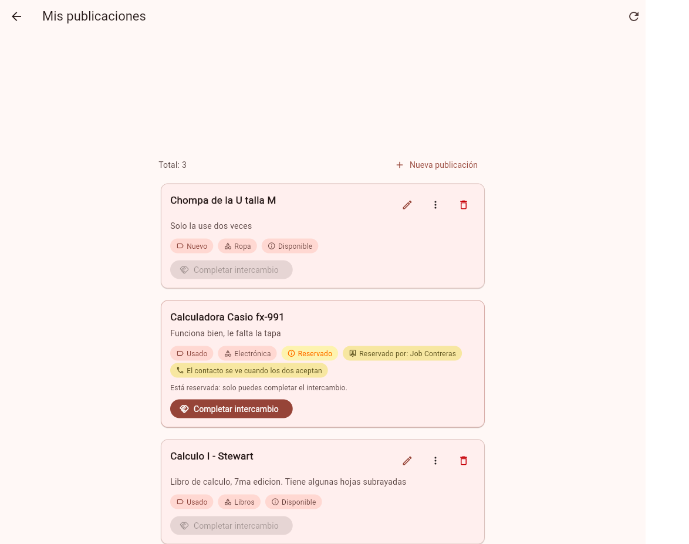

# Clase 22 - Patrones oscuros

## Integrantes

- Gabriel Mamani Sandoval
- Ruben Orestes Justiniano Becerra

Modalidad: sin IA

## 1. Patrón encontrado

Tipo: datos expuestos sin necesidad.

Dónde: Mis publicaciones, tarjeta de la calculadora. Archivo `tarjeta_mi_publicacion.dart`.

La reserva la hace una sola persona. Aun así la tarjeta escribía el teléfono de quien reservó. Ese número se veía antes de que las dos partes aceptaran el intercambio.

## 2. Antes



La etiqueta decía `WhatsApp: 70111222`.

## 3. Después



La tarjeta ya no muestra el número. Dice que el contacto se ve cuando los dos aceptan.

En la API, `getMisPublicaciones` quita el teléfono si el estado no es `acordado`:

```js
if (datos.estado_publicacion !== "acordado" && datos.usuario_reserva) {
  const reserva = { ...datos.usuario_reserva };
  delete reserva.telefono;
  datos.usuario_reserva = reserva;
}
```

Commit: [9bc85aa](https://github.com/gadrilee/TruequeU_2ndP/commit/9bc85aa6291bcc96e44f61af61be2b08f55b398b).

## 4. Principio aplicado

Minimización de datos. El teléfono solo viaja cuando las dos partes ya aceptaron. Antes de eso se ve el nombre de quien reservó, no su número.

## 5. Prueba

`en una reserva el dueño no recibe el teléfono`, en `publicaciones.controlador.test.js`.

Con el código de antes el teléfono venía en la respuesta y la prueba falla. Con el de ahora pasa. El archivo quedó en 12 de 12.

## 6. Otros que encontramos

En el feed, quien reserva todavía puede escribir al dueño por WhatsApp. Eso quedó de una clase anterior y no lo cambiamos hoy.
