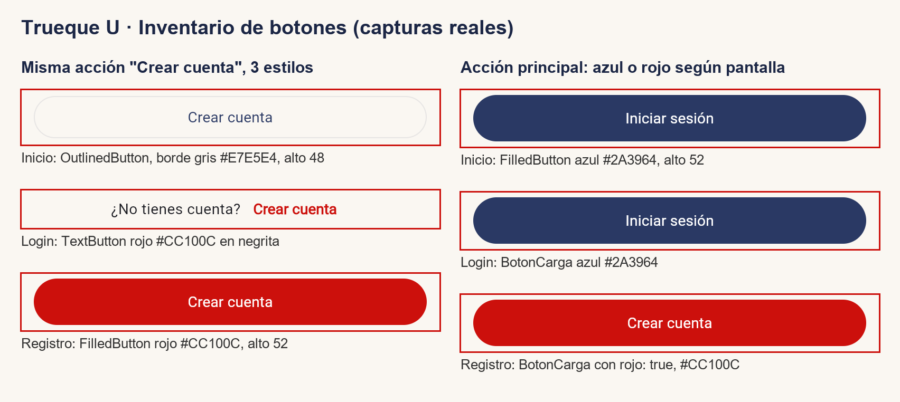

# Clase 23 · Inventario y tokens
**Integrantes:** 
Ruben Orestes Justiniano Becerra
Gabriel Mamani Sandoval

**Modalidad:** sin IA

## 1. Inventario de botones

Sacamos capturas de Inicio, Login y Registro. Los botones toman su estilo de `tema.dart`, pero varias pantallas lo cambian por su cuenta y ahí se notan las diferencias.

- **Diferencias encontradas:**
  - Color y relleno. "Crear cuenta" sale de tres formas distintas. En Inicio es un botón con borde gris, en Login es un texto rojo en negrita y en Registro es un botón rojo lleno. También la acción principal cambia: en Login es azul (`#2A3964`) y en Registro es roja (`#CC100C`). Ese rojo es el mismo que usamos para errores y para eliminar la cuenta, así que crear cuenta se ve como algo peligroso.
  - Altura y estados. Los botones llenos miden 52 y los de borde 48, por eso en Inicio los dos botones de abajo no tienen el mismo alto. En Mis publicaciones el botón "Completar" es más bajo porque usa `VisualDensity.compact`. Solo `BotonCarga` muestra un spinner cuando carga. Los botones de descargar en Mis datos solo se apagan, no avisan que están trabajando. Ninguno tiene un estilo propio para hover.

## 2. Tokens
La app todavía no tiene modo oscuro. Los colores de esa columna son los que proponemos.

| Token | Claro | Oscuro | Dónde se usa |
| :--- | :--- | :--- | :--- |
| `--color-accion-primaria` | `#2A3964` | `#9DB0E8` | Botón principal (Iniciar sesión, Guardar) y borde del campo cuando está seleccionado |
| `--color-fondo-superficie` | `#FAF7F2` | `#14171F` | Fondo de las pantallas y de la barra de arriba |
| `--color-texto-principal` | `#1B2645` | `#E8EAF2` | Títulos y texto sobre fondos claros |
| `--color-borde-sutil` | `#E7E5E4` | `#3A3F4B` | Borde de tarjetas, campos y botones con borde |
| `--color-peligro` | `#CC100C` | `#FF8A80` | Errores, Eliminar cuenta, Cancelar intercambio y Cerrar sesión |

## 3. Colores fijos
- **Pantalla revisada:** Login, `trueque-u/app/lib/pantallas/pantalla_iniciar_sesion.dart` y los widgets que usa (`pagina_acceso.dart` y `encabezado_acceso.dart`)
- **Qué buscamos:** `Color(0x...)`, `Colors.algo`, `#hex`, `fromARGB` y `fromRGBO`
- **Cantidad encontrada:** 3 coincidencias
  - `encabezado_acceso.dart:47` · `Colors.white` en la flecha de volver
  - `encabezado_acceso.dart:56` · `Colors.white` en el título
  - `encabezado_acceso.dart:70` · `Colors.white` en el subtítulo

El archivo de la pantalla no tiene ninguno, todo lo toma del tema. Los tres que salieron están en el encabezado azul.
