# Tarea 10 - Mis datos y salida honesta

## Integrantes

- Gabriel Mamani Sandoval
- Ruben Orestes Justiniano Becerra

## Qué hicimos

- **Mis datos:** en el perfil, cada persona ve todo lo que la app guarda de ella y lo puede descargar en dos formatos de archivo.
- **Eliminar cuenta:** se puede borrar la cuenta con un solo paso y la contraseña. Los trueques en curso se cancelan y a la otra persona le llega un aviso.
- **Avisos:** una pantalla nueva en el perfil donde se ven esos cambios.
- **Botones honestos:** revisamos los cuadros de confirmación y el teléfono para que ningún botón confunda ni se pida más de lo necesario.
- **Pruebas:** revisamos que ningún registro de uso guarde nombre, correo ni teléfono.

## Auditoría de los 6 principios

| Principio | Hallazgo en la app | Corrección aplicada | Estado / Pendiente |
|---|---|---|---|
| 1. Pedir solo lo necesario | El teléfono es opcional, pero el registro no decía para qué se usa | Texto de ayuda bajo el campo: "Solo lo verá la persona con la que acuerdes un trueque. Puedes dejarlo vacío." | Listo |
| 2. Decir para qué se usa cada dato | Quien reservaba veía el teléfono del dueño sin que el dueño hubiera aceptado nada | El teléfono se muestra solo cuando los dos aceptan. La ayuda y los textos de la tarjeta dicen lo mismo | Listo |
| 3. Poder ver y llevarse los datos | No había forma de ver ni descargar lo que la app guarda | Pantalla "Mis datos" con botones para descargar, y botón para quitar el teléfono | Listo |
| 4. Poder salir sin trabas | No existía eliminar la cuenta | "Eliminar cuenta" con un solo paso, sin culpa y con aviso a la otra persona | Listo |
| 5. Botones que no engañan | Al cancelar una oferta, los dos botones decían casi lo mismo. Al eliminar o rechazar, el botón de borrar parecía un "Aceptar" normal | Botones "Volver" y "Sí, cancelar oferta". Las acciones que no se deshacen salen en rojo | Listo |
| 6. No espiar | La app escribía el correo en sus registros internos y los eventos de uso podían llevar datos personales | Se quitó el correo de los registros y el servidor rechaza eventos con nombre, correo o teléfono | Listo |
| Recuperar contraseña | La pantalla dice si un correo existe o no, y cualquiera que conozca un correo puede cambiarle la contraseña a esa cuenta | No lo tocamos en esta tarea | **Pendiente** |

## Patrones oscuros: antes y después

**Cancelar una oferta:** los dos botones decían "Cancelar" y "Cancelar oferta". Ahora dicen "Volver" y "Sí, cancelar oferta".

| Antes | Después |
|---|---|
| 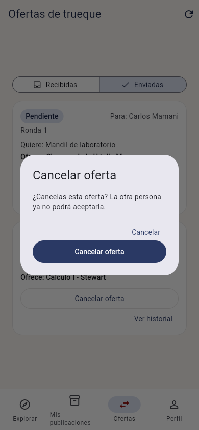 | 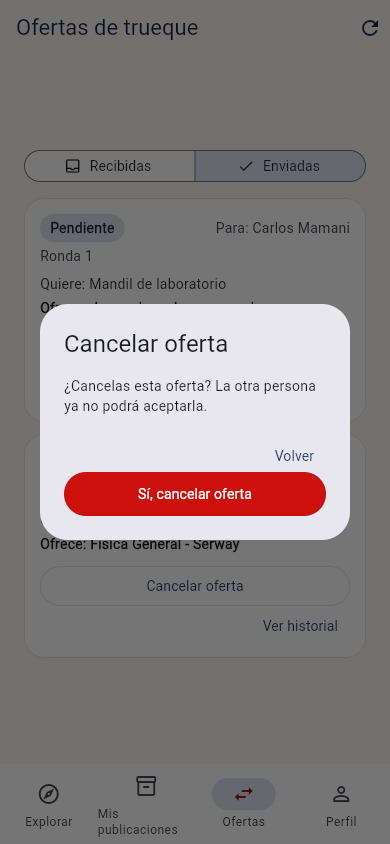 |

**Rechazar una oferta:** el botón que rechaza parecía uno normal. Ahora sale en rojo.

| Antes | Después |
|---|---|
| 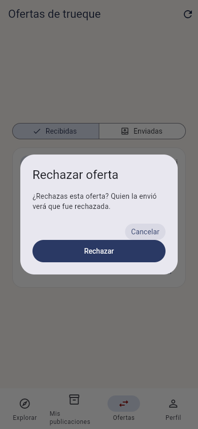 | 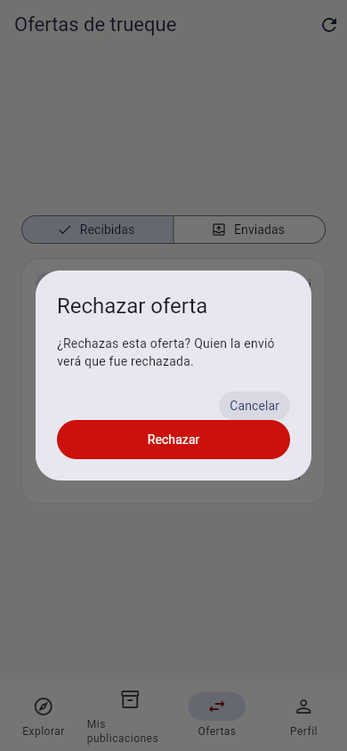 |

**Eliminar una publicación:** igual que el caso anterior, el botón de borrar ahora sale en rojo.

| Antes | Después |
|---|---|
| 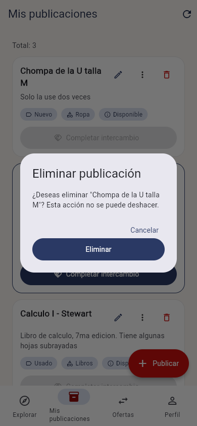 | 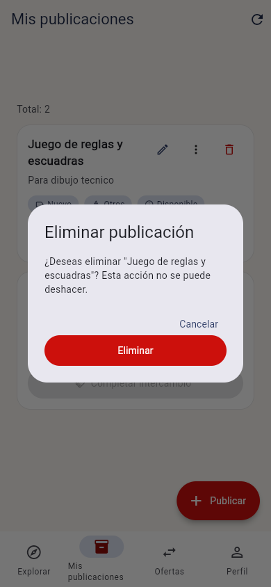 |

**Teléfono en el registro:** el campo no explicaba nada. Ahora dice quién lo verá y que se puede dejar vacío.

| Antes | Después |
|---|---|
| 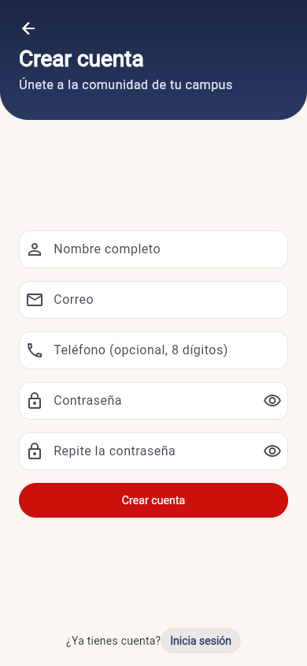 | 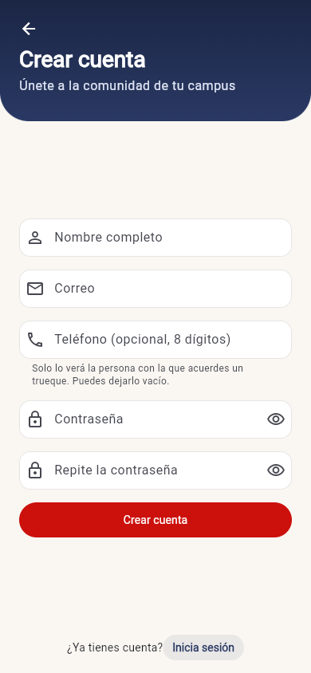 |

**Contacto de quien reservó:** antes aparecía el botón de WhatsApp apenas se reservaba. Ahora aparece el aviso "El contacto se ve cuando los dos aceptan".

| Antes | Después |
|---|---|
| 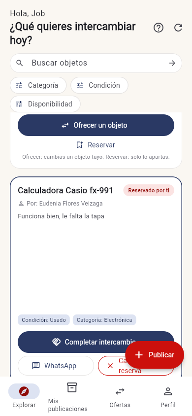 | 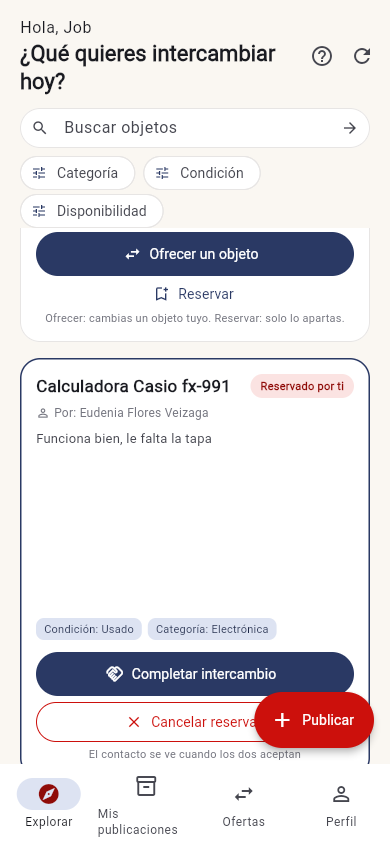 |

**Ayuda sobre WhatsApp:** el texto decía que se podía escribir al dueño enseguida. Ahora explica cuándo aparece el teléfono.

| Antes | Después |
|---|---|
| 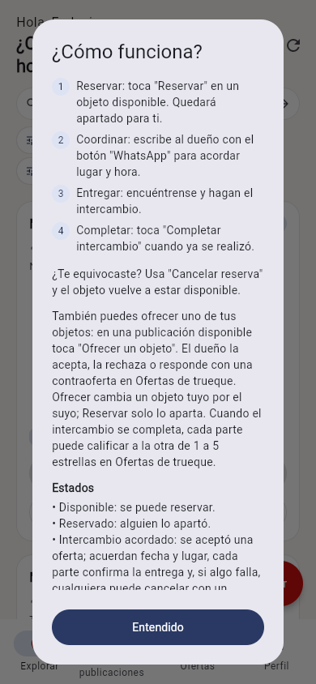 | 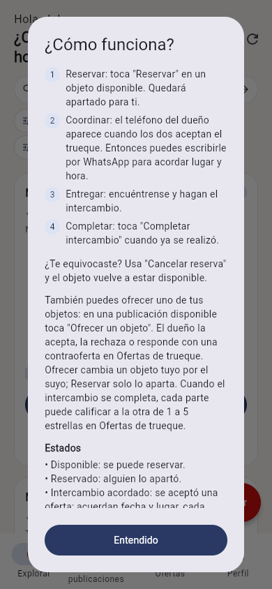 |

## Mis datos

La pantalla muestra el perfil, las publicaciones, las ofertas, las calificaciones y el historial. Desde ahí se descarga todo o se quita el teléfono.

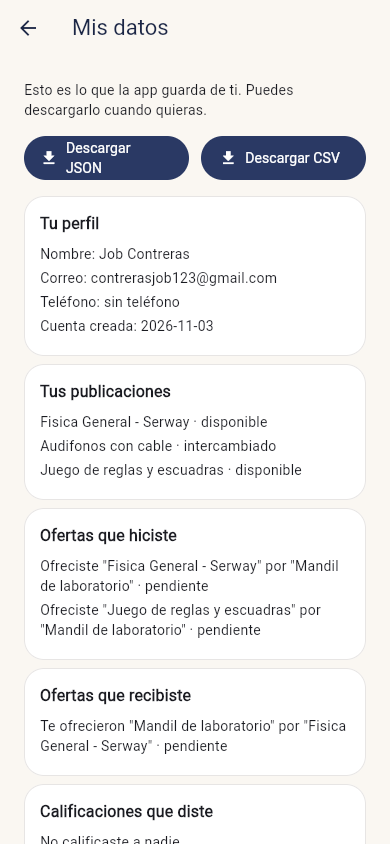

## Eliminar cuenta

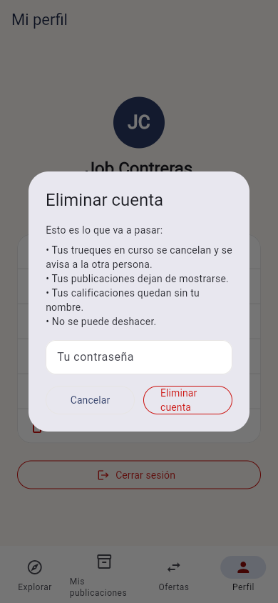

Los dos botones tienen el mismo tamaño y no hay pasos extra. Al confirmar:

- Los trueques en curso se cancelan y a la otra persona le llega un aviso sin culpas.
- Las publicaciones dejan de mostrarse y las calificaciones quedan con el nombre "Usuario eliminado".
- La cuenta ya no puede volver a entrar y no se puede deshacer.
