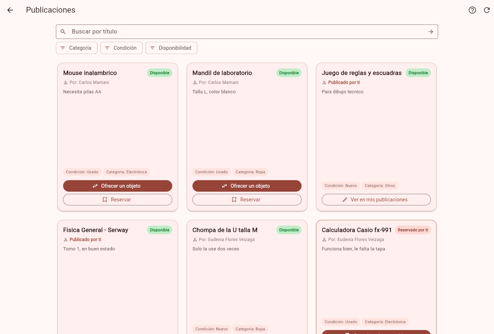
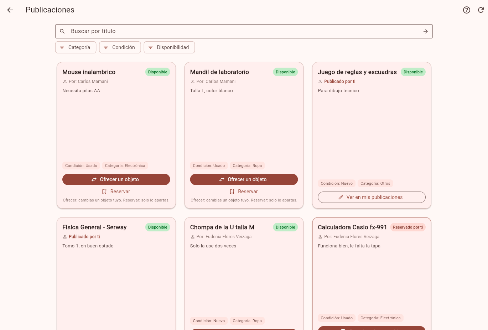
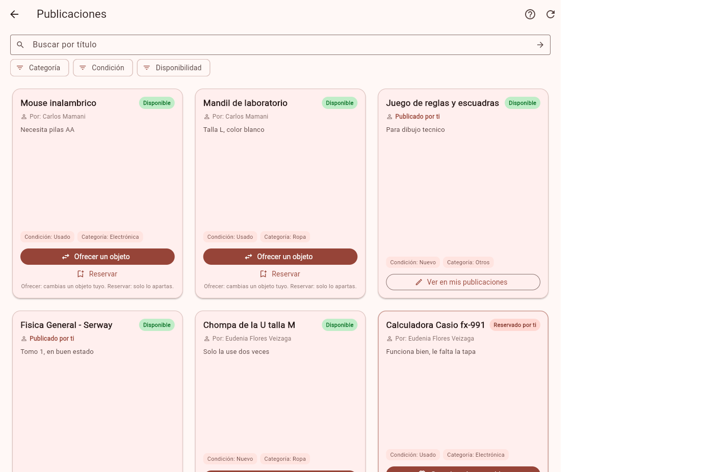
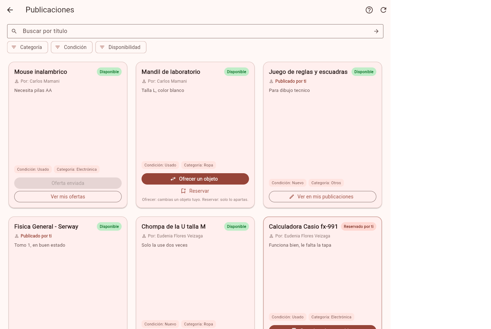
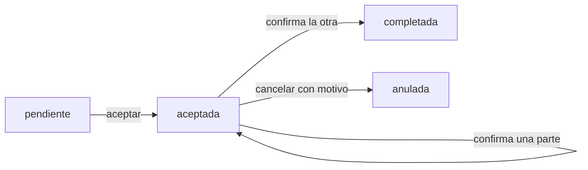

# Tarea 7 - Feedback recibido y completar o cancelar un intercambio

## Feedback recibido

Dos compañeros probaron Trueque U (encontrar una publicación y enviar una oferta):

- [Feedback de Diego Saavedra](https://github.com/DSaav22/Proyecto-2-IHC-Cambiaso/blob/master/clase-19-feedback-a-otro-proyecto/saavedra-alberto/feedback.md)
- [Feedback de Diego Toledo](https://github.com/diego199D/p2-planazo/blob/main/docs/Feedback%20clase%203-nov-2016.md)

Los dos completaron la tarea sin ayuda. Entre los dos coincidieron en algo: en la tarjeta del feed, "Ofrecer un objeto" y "Reservar" parecen lo mismo, y el botón del trueque no convence. Saavedra además notó que después de ofertar la tarjeta no cambia.

Elegimos arreglar estos dos problemas, en este orden: primero el que citan los dos, porque es la entrada del caso de estudio y el cambio es chico; después el de la tarjeta, que se apoya en lo anterior. No tocamos el menú hamburguesa que sugirió Toledo porque obligaba a rehacer casi todas las pruebas que navegan desde el perfil.

## Cambio 1 - Ofrecer pasa a ser la acción principal

Commit: `fix: dar prioridad a ofrecer un objeto sobre reservar`

Pusimos "Reservar" como botón de texto, debajo de "Ofrecer un objeto", con una línea que explica la diferencia ("Ofrecer: cambias un objeto tuyo. Reservar: solo lo apartas.") y lo mismo en la ayuda del feed.

| Antes | Después |
|---|---|
|  |  |

## Cambio 2 - La tarjeta avisa "Oferta enviada"

Commit: `fix: mostrar oferta enviada en la tarjeta del feed`

El feed ahora pregunta a la base qué ofertas pendientes tengo. Si ya ofrecí por una publicación, la tarjeta muestra "Oferta enviada" y el botón "Ver mis ofertas". El dato viene de la base, así que se mantiene al recargar.

| Antes | Después |
|---|---|
|  |  |

## Funcionalidad: completar o cancelar un intercambio acordado

Commit: `feat: confirmar entrega o cancelar con motivo un intercambio acordado`

Antes, aceptar una oferta daba el trueque por hecho. Ahora aceptar es solo el acuerdo:

Reglas que quedaron:

- Al aceptar, las dos publicaciones pasan a `acordado` y las otras ofertas pendientes de esos objetos se cancelan. Un objeto `acordado` no se reserva, edita, borra ni oculta.
- Cada parte confirma su entrega. Con una sola confirmación no se completa. Con las dos, el intercambio pasa a `completada`, las publicaciones a `intercambiado` y se guarda en el historial.
- Antes de completarse, cualquiera de las dos partes puede cancelar, pero tiene que escribir un motivo. Las dos publicaciones vuelven a `disponible`, el motivo queda guardado y las ofertas que ya estaban canceladas no se reactivan.

Qué cambió:

| Parte | Cambio |
|---|---|
| Datos | `migracion_intercambio_acordado.sql` y `estructura.sql`: estado `acordado` en publicaciones; estados `completada` y `anulada`, confirmaciones y motivo en ofertas |
| Reglas | `reglasObjeto.js`: `puedeConfirmarEntrega` y `puedeCancelarIntercambio` |
| API | `PUT /api/ofertas/:id/entrega` y `PUT /api/ofertas/:id/anulada` con `{ motivo }` |
| Pantallas | En Ofertas de trueque: quién ya confirmó, "Confirmar entrega", "Cancelar intercambio" con motivo, y los estados completado y cancelado. Chip "Intercambio acordado" en el feed y en Mis publicaciones |
| Pruebas | `reglaIntercambio.test.js`, `ofertas.intercambio.test.js` y `intercambio_acordado_test.dart` (8 pruebas). Ajustamos las que asumían que aceptar completaba el intercambio |

### Escenario mínimo

Lo cubre `intercambio_acordado_test.dart`:

1. **La primera confirmación no completa, la segunda sí.** Eudenia acepta la oferta de Carlos y confirma: ve "Tu entrega: confirmada", "La otra persona: pendiente" y todavía no tiene intercambios completados. Carlos confirma y el intercambio queda completado, con los dos objetos en Intercambios completados.
2. **Cancelar libera la publicación y conserva el motivo.** En otro intercambio, Eudenia cancela con el motivo "No pude ir a la entrega": ve "Intercambio cancelado" con su motivo, el libro vuelve a aparecer disponible en el feed y la oferta anterior de Job sigue cancelada.

### Resultado de las pruebas

Se corren en Ubuntu, con el escritorio Linux y la base en Docker. Las salidas completas están en `tarea-7/suite-backend.txt` y `tarea-7/suite-flutter.txt`.

| Suite | Antes (tarea 6) | Ahora |
|---|---|---|
| Backend (jest) | 57 de 57 | 73 de 73 |
| E2E Flutter | 99 de 99 | 107 de 107 |
