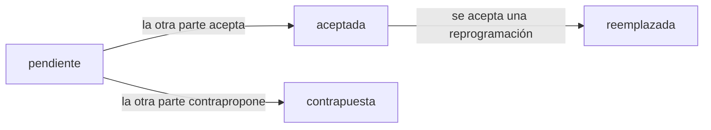
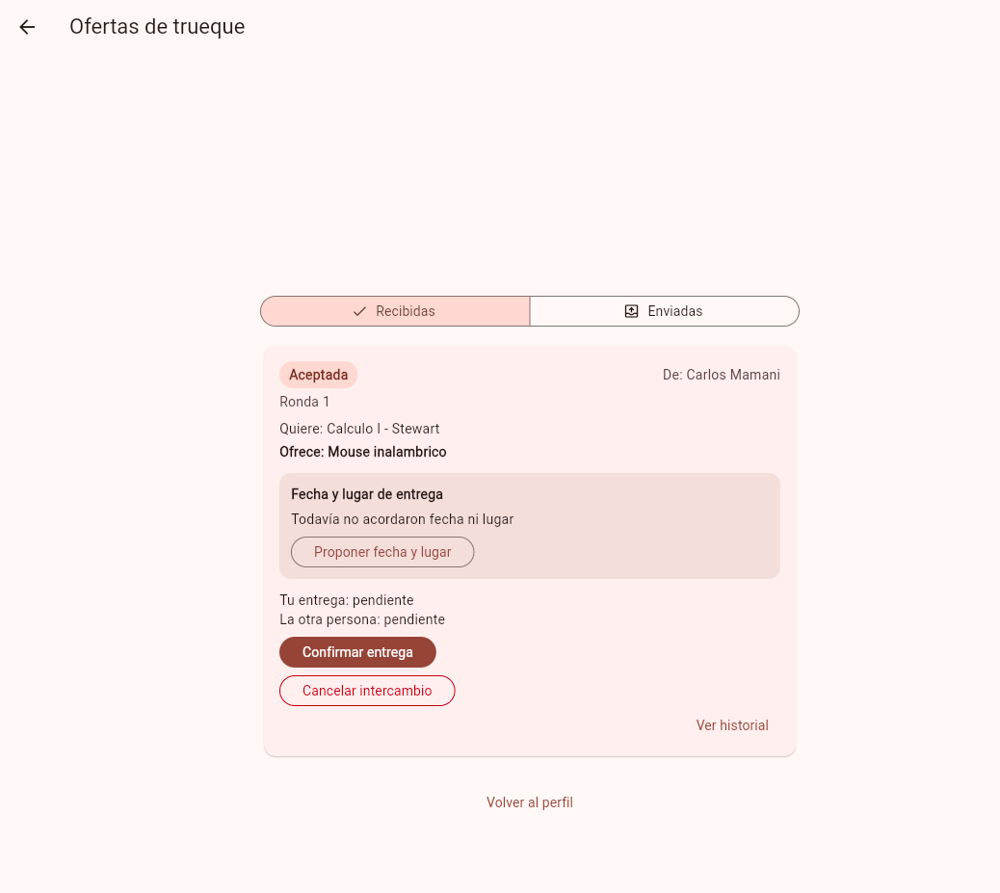
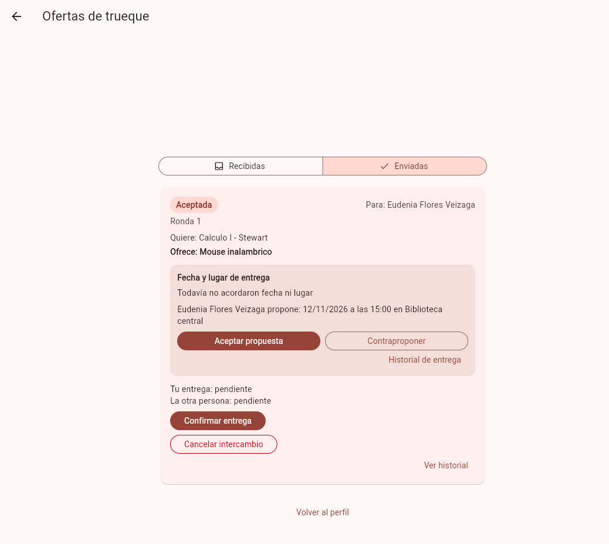
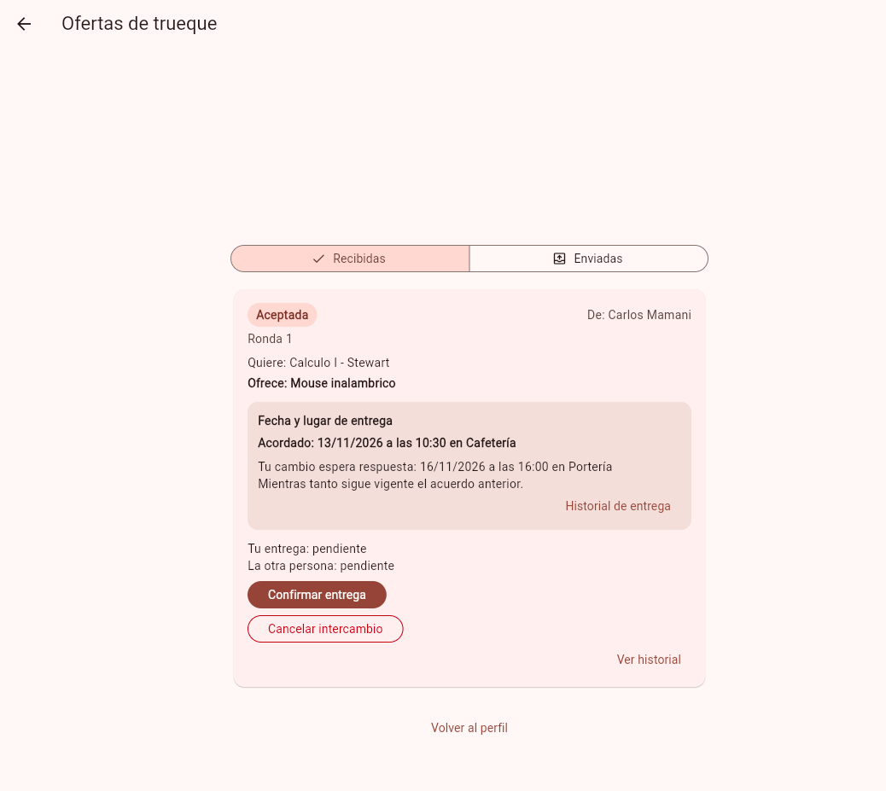
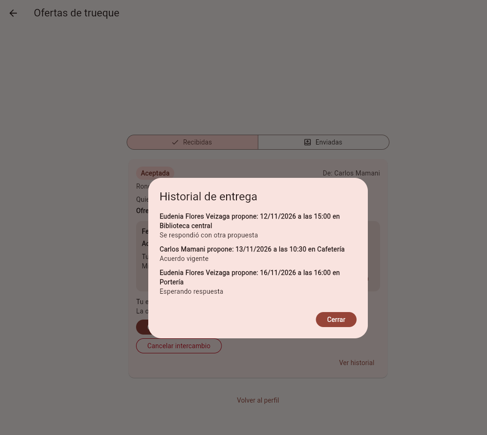

# Tarea 8 - Coordinar la entrega

## Integrantes

- Gabriel Mamani Sandoval
- Ruben Orestes Justiniano Becerra

## Qué hicimos

Cuando una oferta se acepta, las dos personas todavía tienen que ponerse de acuerdo en **cuándo y dónde** se hace la entrega. Ahora la app lo resuelve dentro de la misma tarjeta de la oferta aceptada:

1. Una parte propone fecha, hora y lugar.
2. La otra puede **aceptar** o **contraproponer**.
3. Cuando se acepta, ese queda como el acuerdo vigente.
4. Después cualquiera puede pedir una **reprogramación**. Mientras la otra parte no la acepte, **sigue valiendo el acuerdo anterior**.
5. Todo queda en un historial.



Reglas que quedaron:

- Solo puede haber **una propuesta pendiente** por intercambio. Mientras exista, nadie puede mandar otra.
- Solo las dos partes del intercambio pueden participar. Y quien propuso **no puede responder su propia propuesta**.
- Solo se coordina mientras el intercambio está aceptado. Antes de aceptar la oferta, o después de completarlo o cancelarlo, no se puede.
- La fecha no puede haber pasado y hay que escribir hora y lugar.

## Cómo lo hicimos (de la pantalla a la base de datos)

| Capa | Qué se hizo |
|---|---|
| Interfaz | Un bloque "Fecha y lugar de entrega" dentro de la tarjeta de la oferta aceptada, con botones según quién eres y qué hay pendiente, y un diálogo con el historial |
| Reglas y permisos | Las reglas viven en funciones chicas (`reglasEntrega.js`) y la API solo las llama y guarda el resultado |
| Datos | Tabla nueva `propuestas_entrega`. La base misma impide dos pendientes o dos acuerdos vigentes en una oferta |
| E2E | Una prueba del recorrido completo y cuatro de restricciones |

### Decisiones

- **Una tabla nueva y no columnas en `ofertas`.** Así el historial sale gratis: cada propuesta es una fila y solo cambia su estado (`pendiente`, `aceptada`, `contrapuesta`, `reemplazada`).
- **Sin pantalla nueva.** La coordinación se hace en la tarjeta de la oferta aceptada, que es donde la persona ya está pensando en la entrega.
- **Fecha y hora se escriben a mano** (dd/mm/aaaa y hh:mm). El selector de fecha de Flutter salía en inglés y no queríamos agregar librerías de idioma por esto.
- **Antes de implementar revisamos qué refactorizar.** `ofertas.controlador.js` (545 líneas) y `pantalla_ofertas.dart` (544) ya están grandes, así que el código nuevo va en archivos propios. Solo hicimos el refactor mínimo: sacar `idValido` a `utils/idValido.js` y exportar `parteDelIntercambio` para reutilizarlos sin copiarlos.
- **No tocamos** la confirmación ni la cancelación de la tarea 7.

## Archivos afectados

| Parte | Archivos |
|---|---|
| Refactor | `backend/src/utils/idValido.js` (nuevo), `ofertas.controlador.js`, `reglasObjeto.js` |
| Datos | `base_de_datos/migracion_propuestas_entrega.sql` (nuevo), `estructura.sql`, `backend/src/models/propuestas_entrega.js` (nuevo), `init-models.js`, `entorno_e2e.js` |
| Reglas y API | `backend/src/utils/reglasEntrega.js`, `controllers/propuestasEntrega.controlador.js`, `routes/propuestasEntrega.rutas.js` (todos nuevos), `routes/index.js` |
| App | `formato_entrega.dart`, `dialogo_entrega.dart`, `bloque_entrega.dart` (nuevos), `controlador_autenticacion.dart`, `pantalla_ofertas.dart`, `dialogo_ayuda.dart` |
| Pruebas | `reglasEntrega.test.js` y `propuestasEntrega.controlador.test.js` (nuevos), `coordinar_entrega_test.dart` (nuevo), `ayudantes.dart`, `intercambio_acordado_test.dart` |

### El código en pocas palabras

- **`reglasEntrega.js`**: decide si se puede proponer, aceptar o contraproponer. Devuelve un error con su código: `400` datos mal escritos, `403` no eres parte o es tu propia propuesta, `409` no se puede por el estado actual (oferta no aceptada, ya hay una pendiente, ya fue respondida).
- **`propuestasEntrega.controlador.js`**: cuatro endpoints en `/api/propuestas-entrega` (`GET /?id_oferta=`, `POST /`, `POST /:id/contrapropuesta`, `PUT /:id/aceptada`). Cada uno trabaja en una transacción y bloquea la oferta, para que dos personas respondiendo al mismo tiempo no se pisen. Al contraproponer primero se marca la anterior como `contrapuesta` y luego se crea la nueva; al aceptar una reprogramación primero se marca el acuerdo viejo como `reemplazada`. Ese orden evita chocar con los índices únicos.
- **`bloque_entrega.dart`**: pide a la API la entrega de la oferta y dibuja lo que toca: sin fecha, acuerdo vigente, propuesta pendiente (tuya o de la otra persona) y el historial.
- **`dialogo_entrega.dart`** y **`formato_entrega.dart`**: el formulario de fecha, hora y lugar con sus validaciones, y las funciones para convertir entre `dd/mm/aaaa` y el formato de la API.

## Capturas

| 1. Aceptada, sin fecha | 2. La otra parte ve la propuesta |
|---|---|
|  |  |

| 3. Acuerdo vigente y reprogramación pendiente | 4. Historial |
|---|---|
|  |  |

## Pruebas

Las E2E están en `coordinar_entrega_test.dart` (5 pruebas):

1. **Recorrido completo.** Eudenia propone, Carlos contrapropone, Eudenia acepta. Se recarga la app y el acuerdo sigue ahí. Luego Eudenia pide una reprogramación: mientras está pendiente se sigue viendo el acuerdo anterior. Carlos la acepta, se recarga otra vez y se revisa el historial.
2. **Solo las partes participan y nadie responde lo suyo.** Una tercera persona (Job) no puede ver, proponer, aceptar ni contraproponer: recibe `403`. Y quien propuso tampoco puede aceptar su propia propuesta (`403`).
3. **Una sola pendiente.** Una segunda propuesta, de quien propuso o de la otra parte, recibe `409`. Mientras la reprogramación no se acepte, el acuerdo vigente no cambia. Repetir el mismo acuerdo también se rechaza.
4. **Fuera de estado.** No se puede coordinar antes de aceptar la oferta ni después de completar el intercambio (`409`).
5. **Datos inválidos.** La app no envía fechas pasadas ni campos vacíos y la API responde `400`.

Las fechas se calculan a partir de "hoy" y la base se reinicia con `datos.sql` antes de cada archivo, así que las pruebas se pueden repetir cuando quieras.

### Cómo correrlas

Desde `trueque-u`, con Docker abierto:

```bash
docker compose up -d
node app/integration_test/herramientas/entorno_e2e.js
```

En otra terminal, desde `trueque-u/app`, un archivo a la vez (en Mac cambia `-d linux` por `-d macos`; en Windows usa el `flutter drive` que explica el README):

```bash
flutter test integration_test/coordinar_entrega_test.dart -d linux
```

Y las del backend:

```bash
cd trueque-u/backend
npm test
```

### Resultado de la suite

Se corrió todo, también lo anterior, para ver si algo se rompió. Las salidas completas están en `tarea-8/suite-backend.txt` y `tarea-8/suite-flutter.txt`.

| Suite | Antes (tarea 7) | Ahora |
|---|---|---|
| Backend (jest) | 73 de 73 | 105 de 105 |
| E2E Flutter | 107 de 107 | 112 de 112 |

No quedaron fallos pendientes. Lo que sí queda fuera por ahora: no hay botón de "rechazar" una propuesta (se acepta o se contrapropone), y si el intercambio se completa o se cancela con una propuesta pendiente, esa fila queda guardada pero la app ya no deja responderla.

## Commits

| Parte | Mensaje | Enlace |
|---|---|---|
| 1 | `refactor: sacar idValido a utils` | [df24d34](https://github.com/gadrilee/TruequeU_2ndP/commit/df24d34bc2b41afc127b1c230bbfd00fc2c16e38) |
| 2 | `feat: tabla de propuestas de entrega` | [9b3e55b](https://github.com/gadrilee/TruequeU_2ndP/commit/9b3e55b803ae92fcf540675340e30625d425a628) |
| 3 | `feat: proponer, contraproponer y aceptar la entrega en la api` | [ad8ccbb](https://github.com/gadrilee/TruequeU_2ndP/commit/ad8ccbb73e8285c7596b662d9305c4e9196f4fb6) |
| 4 | `feat: coordinar fecha y lugar de entrega en ofertas` | [ae05a16](https://github.com/gadrilee/TruequeU_2ndP/commit/ae05a16e2d72db08c9a1dc6cca45aeda16a1319a) |
| 5 | `test: probar la coordinacion de la entrega de punta a punta` | [d3aa437](https://github.com/gadrilee/TruequeU_2ndP/commit/d3aa437b6d5c5522280a8902cbeb6c8d380960c7) |
