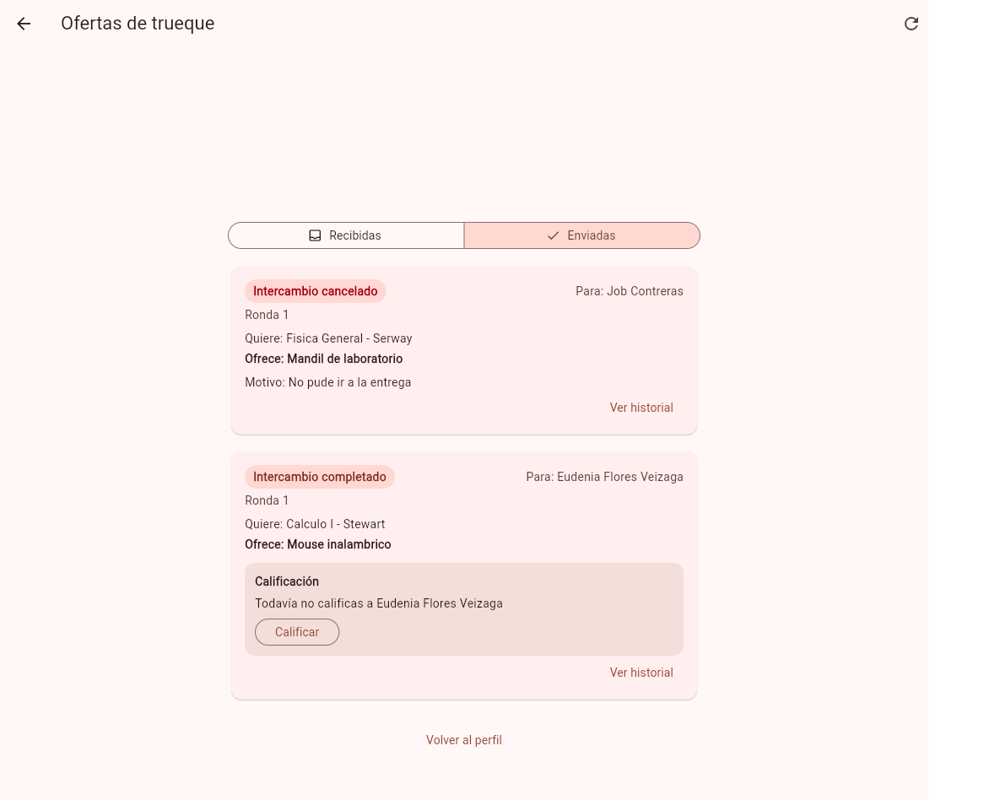
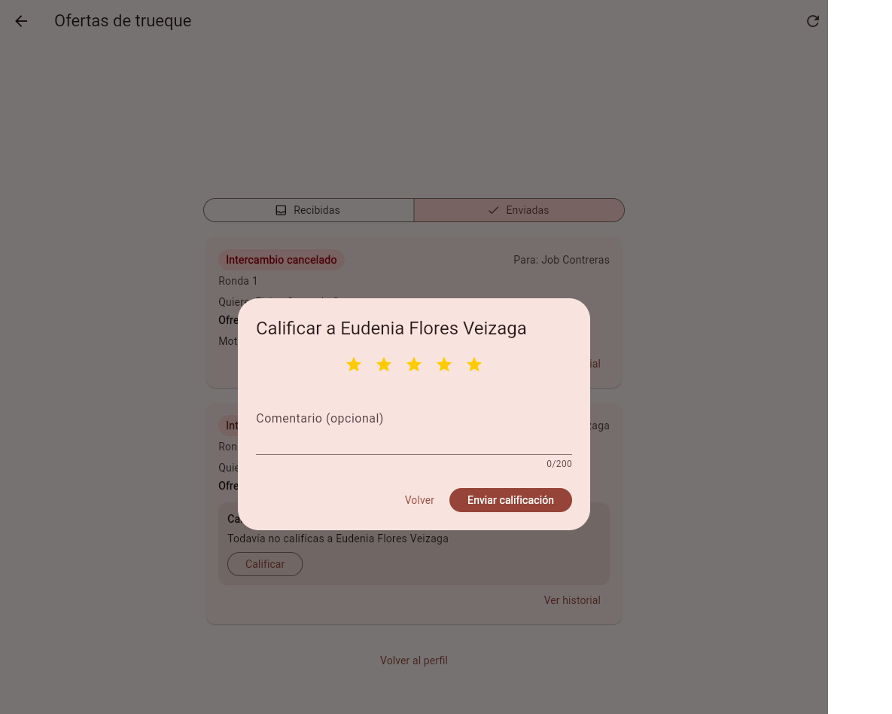
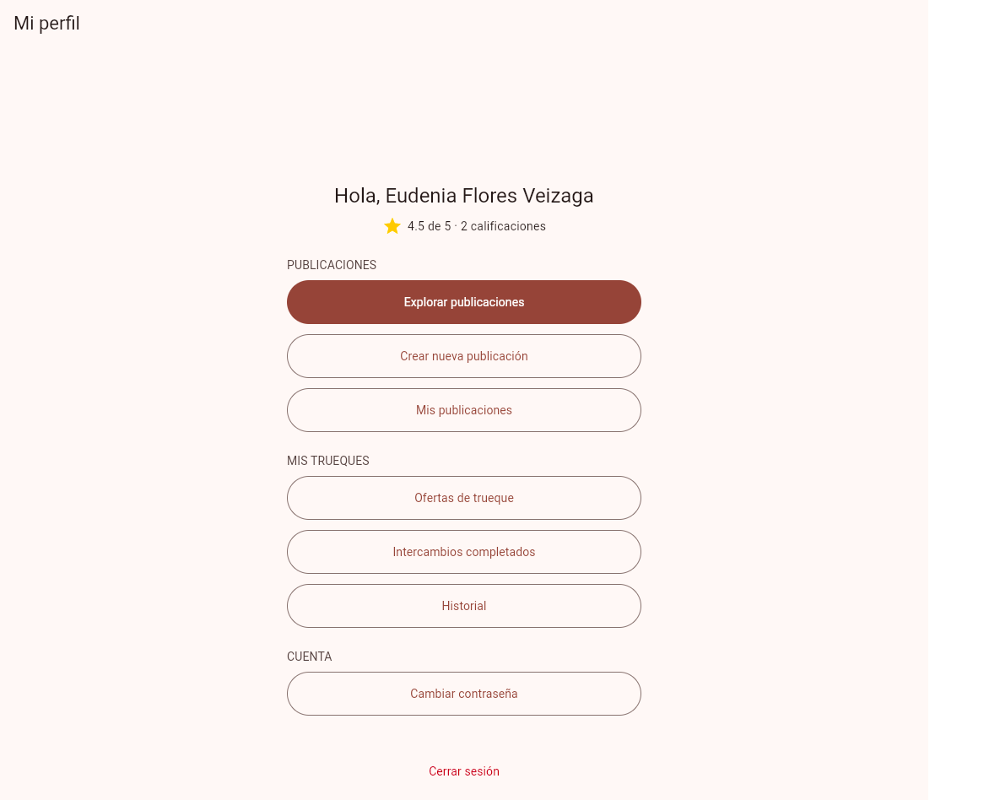
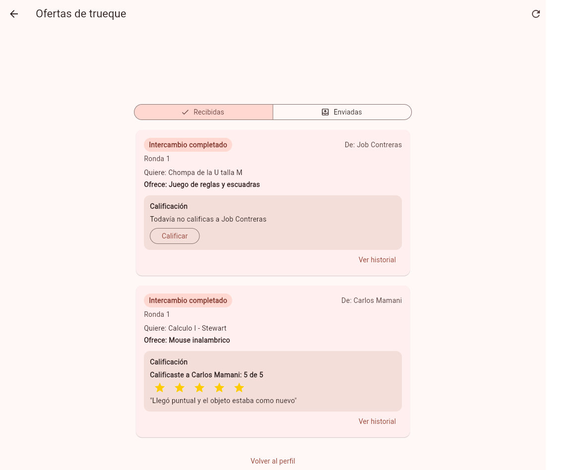

# Tarea 9 - Calificar un intercambio

## Integrantes

- Gabriel Mamani Sandoval
- Ruben Orestes Justiniano Becerra

## Qué hicimos

Cuando un intercambio termina, cada parte puede **calificar a la otra con estrellas** (de 1 a 5) y dejar un comentario si quiere. En el perfil de cada persona aparece el **promedio y cuántas calificaciones** tiene.

Reglas que quedaron:

- Solo se califica un intercambio **completado**. Uno cancelado, aceptado o pendiente se rechaza (`409`).
- Solo las dos partes del intercambio pueden calificar (`403` para cualquier otra persona).
- **Cada parte califica una sola vez.** La segunda calificación se rechaza (`409`) y la primera no cambia.
- El puntaje es un número entero de 1 a 5. El comentario es opcional y tiene hasta 200 letras (`400` si algo no cumple).
- Nadie se califica a sí mismo: la API calcula a quién se califica según de qué lado del intercambio estás.
- El perfil muestra el promedio con un decimal y la cantidad (por ejemplo "4.5 de 5 · 2 calificaciones"), o "Aún no tienes calificaciones".

Un "intercambio" es una oferta de trueque. Se califica en **Ofertas de trueque**, en la tarjeta que dice "Intercambio completado".

## Cómo lo hicimos (de la pantalla a la base de datos)

| Capa | Qué se hizo |
|---|---|
| Interfaz | Cinco estrellas que se tocan en un diálogo, un bloque "Calificación" dentro de la tarjeta del intercambio completado y una línea de promedio en el perfil |
| Reglas y permisos | Las reglas viven en funciones chicas (`reglasCalificacion.js`) y la API solo las llama y guarda el resultado |
| Datos | Tabla nueva `calificaciones`. La base misma impide dos calificaciones de la misma persona en un intercambio, puntajes fuera de 1 a 5 y calificarse a uno mismo |
| Analítica | Dos eventos con la analítica que ya hizo Ruben, en un commit aparte |
| E2E | Cinco pruebas de la funcionalidad y dos de la analítica |

### Decisiones

- **La calificación cuelga de la oferta.** Cada fila guarda la oferta, quién califica y a quién. Así sale solo que son dos calificaciones por intercambio, una por cada parte.
- **Estrellas con botones de Flutter**, sin librerías. Cada estrella tiene su texto ("4 de 5") para que también se pueda usar con lector de pantalla.
- **Sin pantalla nueva.** Se califica en la tarjeta del intercambio, que es donde la persona ya está pensando en él.
- **El promedio se calcula en la base** (`AVG` y `COUNT`) y no en la app.
- **Antes de implementar revisamos qué reutilizar.** `cargarOferta` ya existía dentro de `propuestasEntrega.controlador.js` y la necesitábamos también aquí, así que la movimos a `utils/cargarOferta.js` en vez de copiarla.
- **No tocamos** la analítica de Ruben (`track`, `/eventos` y `/analitica`): solo la usamos.

## Archivos afectados

| Parte | Archivos |
|---|---|
| Refactor | `backend/src/utils/cargarOferta.js` (nuevo), `propuestasEntrega.controlador.js` |
| Datos | `base_de_datos/migracion_calificaciones.sql` (nuevo), `estructura.sql`, `backend/src/models/calificaciones.js` (nuevo), `init-models.js`, `entorno_e2e.js` |
| Reglas y API | `backend/src/utils/reglasCalificacion.js`, `controllers/calificaciones.controlador.js`, `routes/calificaciones.rutas.js` (todos nuevos), `routes/index.js` |
| App | `estrellas.dart`, `dialogo_calificacion.dart`, `bloque_calificacion.dart`, `resumen_calificaciones.dart` (nuevos), `controlador_autenticacion.dart`, `pantalla_ofertas.dart`, `pantalla_perfil.dart`, `dialogo_ayuda.dart` |
| Analítica | `bloque_calificacion.dart`, `entorno_e2e.js` (agrega la tabla `eventos` al entorno de pruebas), `analitica_calificaciones_test.dart` (nuevo) |
| Pruebas | `reglasCalificacion.test.js` y `calificaciones.controlador.test.js` (nuevos), `calificar_intercambio_test.dart` (nuevo) |

### El código en pocas palabras

- **`reglasCalificacion.js`**: decide si se puede calificar y a quién. Devuelve el error con su código: `403` no eres parte, `409` cancelado, sin completar o ya calificaste, `400` puntaje o comentario inválidos.
- **`calificaciones.controlador.js`**: tres endpoints en `/api/calificaciones`: `GET /?id_oferta=` (mi calificación de ese intercambio), `POST /` (calificar) y `GET /resumen?id_usuario=` (promedio y cantidad). Si dos pedidos llegan al mismo tiempo, el índice único de la base rechaza el segundo y la API responde `409`.
- **`estrellas.dart`**: cinco estrellas; si recibe `alElegir` se pueden tocar y si no, solo se muestran.
- **`dialogo_calificacion.dart`**: el diálogo con las estrellas y el comentario. No deja enviar sin elegir estrellas.
- **`bloque_calificacion.dart`**: pregunta a la API si ya calificaste. Si no, muestra el botón **Calificar**; si ya, tus estrellas y tu comentario.
- **`resumen_calificaciones.dart`**: la línea del promedio y la cantidad en el perfil.

### Analítica (commit aparte)

Se usa la función `track` que ya existe, igual que en las ofertas:

| Evento | Cuándo se registra | Datos |
|---|---|---|
| `calificacion_iniciada` | La persona toca **Calificar** y se abre el diálogo | `id_oferta` |
| `calificacion_enviada` | La API guardó la calificación | `id_oferta`, `puntaje`, `con_comentario` |

La diferencia entre los dos eventos dice cuántas personas abren el diálogo y no terminan. El único cambio fuera de los eventos es en `entorno_e2e.js`: ahora también crea la tabla `eventos`, para poder probarlos.

## Capturas

| 1. Completado con botón, cancelado sin botón | 2. Diálogo con estrellas |
|---|---|
|  |  |

| 3. Después de calificar | 4. Perfil con promedio y cantidad |
|---|---|
|  |  |

| 5. Una calificación con comentario y otro intercambio por calificar |
|---|
|  |

- En la captura 1 es Carlos viendo sus ofertas enviadas: el intercambio cancelado no tiene ningún bloque de calificación y el completado tiene el botón.
- En la 4 el promedio de Eudenia es 4.5 porque Carlos le puso 5 (captura 3) y Job le puso 4.
- Las respuestas reales de la API a los casos rechazados (segunda calificación, intercambio cancelado, persona ajena y puntaje inválido), junto con el resumen y los eventos, están en [`tarea-9/api-rechazos.txt`](tarea-9/api-rechazos.txt).

## Pruebas

**`calificar_intercambio_test.dart`** (5 pruebas):

1. **Ambas partes califican.** Eudenia califica a Carlos con 4 estrellas y un comentario; su perfil sigue sin calificaciones y el de Carlos muestra "4.0 de 5 · 1 calificación". Carlos califica a Eudenia con 5 y el perfil de ella muestra "5.0 de 5 · 1 calificación". Se recarga la app y la calificación sigue ahí.
2. **El perfil promedia todo.** Eudenia recibe un 5 y un 4 de dos intercambios distintos y su perfil muestra "4.5 de 5 · 2 calificaciones".
3. **Una sola calificación por parte.** La segunda calificación de Eudenia recibe `409` ("Ya calificaste este intercambio") y el promedio de Carlos no cambia. Carlos todavía puede calificar la suya y luego le pasa lo mismo.
4. **Cancelado o sin completar.** Un intercambio pendiente o aceptado recibe `409` ("Solo se puede calificar un intercambio completado"). Una vez cancelado, las dos partes reciben `409` ("Un intercambio cancelado no se puede calificar"), nadie suma calificaciones y en la tarjeta no aparece el botón.
5. **Solo las partes y puntaje de 1 a 5.** Job no participó y recibe `403`. Los puntajes 0, 6, 3.5, "4" y vacío reciben `400`, igual que un comentario de 201 letras; uno de 200 sí se acepta.

**`analitica_calificaciones_test.dart`** (2 pruebas): al tocar **Calificar** sube `calificacion_iniciada` y `calificacion_enviada` no se mueve; al enviar sube `calificacion_enviada`. Si se cierra el diálogo con **Volver**, solo sube `calificacion_iniciada`. Como la tabla `eventos` no se vacía entre pruebas, se compara el total de antes con el de después.

Las pruebas del backend son 26 de reglas y 15 del controlador. La base se reinicia con `datos.sql` antes de cada archivo, así que se pueden repetir cuando quieras.

### Cómo correrlas

Desde `trueque-u`, con Docker abierto:

```bash
docker compose up -d
node app/integration_test/herramientas/entorno_e2e.js
```

En otra terminal, desde `trueque-u/app`, un archivo a la vez (en Mac cambia `-d linux` por `-d macos`; en Windows usa el `flutter drive` que explica el README):

```bash
flutter test integration_test/calificar_intercambio_test.dart -d linux
flutter test integration_test/analitica_calificaciones_test.dart -d linux
```

Y las del backend:

```bash
cd trueque-u/backend
npm test
```

Si ya tenías la base de Docker creada de antes, agrega la tabla nueva una vez:

```bash
docker exec -i trueque_u_bd psql -U postgres -d trueque_u < trueque-u/base_de_datos/migracion_calificaciones.sql
```

### Resultado de la suite

Se corrió todo, también lo anterior, para ver si algo se rompió. Las salidas están en `tarea-9/suite-backend.txt` y `tarea-9/suite-flutter.txt`.

| Suite | Antes (tarea 8) | Ahora |
|---|---|---|
| Backend (jest) | 105 de 105 | 150 de 150 |
| E2E Flutter | 112 de 112 | 119 de 119 |

En el backend se suman 41 pruebas nuestras y 4 de la analítica de Ruben. No quedaron fallos pendientes.

Lo que queda fuera por ahora:

- Solo se califican los intercambios hechos con **oferta**. El flujo viejo de reservar y completar no tiene oferta, así que no se puede calificar.
- Una calificación no se puede editar ni borrar.
- El perfil muestra el promedio y la cantidad, pero no la lista de comentarios, y todavía no se puede ver el perfil de otra persona.

## Commits

| Parte | Mensaje | Enlace |
|---|---|---|
| 1 | `refactor: sacar cargarOferta a utils` | [10165c2](https://github.com/gadrilee/TruequeU_2ndP/commit/10165c2121d9c938f5ce0b6d0a56cf71341e85cb) |
| 2 | `feat: tabla de calificaciones` | [b17a8ad](https://github.com/gadrilee/TruequeU_2ndP/commit/b17a8ad5500e40998109b4ab1c2bdc4feb9959c3) |
| 3 | `feat: reglas para calificar un intercambio` | [59f9938](https://github.com/gadrilee/TruequeU_2ndP/commit/59f9938b2d294243c5706b4660ef734d483d364a) |
| 4 | `feat: calificar y ver el resumen en la api` | [0c294d2](https://github.com/gadrilee/TruequeU_2ndP/commit/0c294d233b9e4d5f97671cbc775d9fee0b6e955f) |
| 5 | `feat: estrellas y dialogo para calificar` | [0a99ced](https://github.com/gadrilee/TruequeU_2ndP/commit/0a99cedc48860c16e71851a87ca8790b5739cc6f) |
| 6 | `feat: calificar desde las ofertas completadas` | [15955c1](https://github.com/gadrilee/TruequeU_2ndP/commit/15955c1629b5f5e9419b44444618a9e1930996a1) |
| 7 | `feat: promedio y cantidad de calificaciones en el perfil` | [efd0c90](https://github.com/gadrilee/TruequeU_2ndP/commit/efd0c908f771b5d6d626c281c1e21a81ecfcdc93) |
| 8 | `test: probar la calificacion de punta a punta` | [2f8f321](https://github.com/gadrilee/TruequeU_2ndP/commit/2f8f32128e31cbca1e2d116504f6b062aa1dcc2a) |
| 9 (analítica) | `feat: registrar eventos de calificacion` | [ba4fb77](https://github.com/gadrilee/TruequeU_2ndP/commit/ba4fb77563d87db5b6af68c573d1d64c932fc096) |
